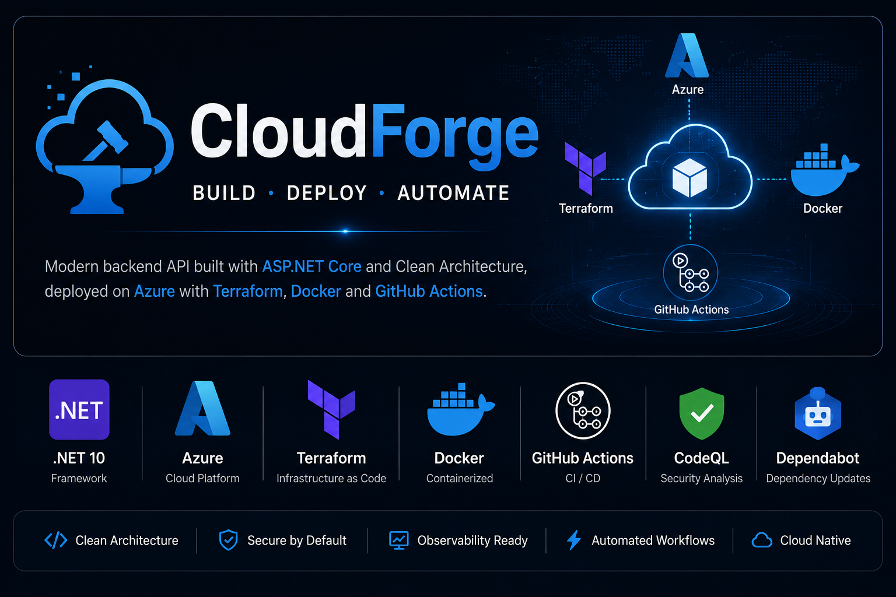
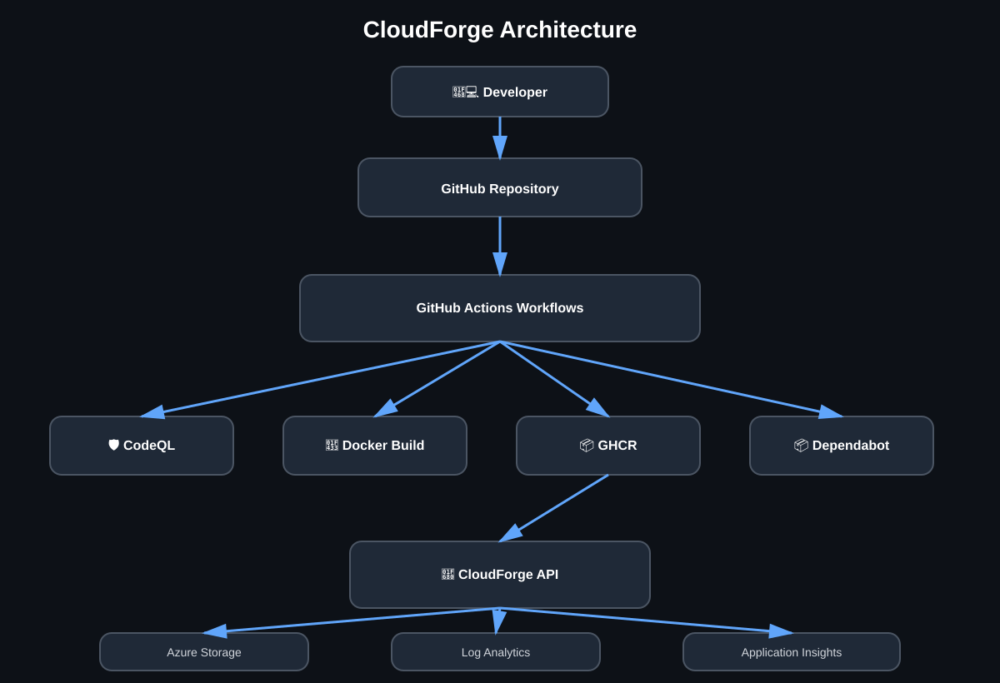

<p align="center">
  
</p>

# 🚀 CloudForge

> **Proyecto de portfolio DevOps desarrollado con ASP.NET Core, Terraform, Docker, Azure y GitHub Actions.**


---

# 📖 Descripción

CloudForge es un proyecto de portfolio cuyo objetivo es demostrar conocimientos reales en desarrollo backend, infraestructura como código (IaC), automatización, contenedores y tecnologías Cloud.

No se trata de un proyecto de ejemplo, sino de una plataforma diseñada para aplicar prácticas utilizadas en entornos profesionales:

- Arquitectura limpia (Clean Architecture).
- Infraestructura desplegada mediante Terraform.
- Contenedores Docker.
- Integración Continua con GitHub Actions.
- Servicios de Azure.
- Pruebas automatizadas.

---

# 🛠️ Tecnologías utilizadas

| Categoría | Tecnologías |
|-----------|-------------|
| Backend | ASP.NET Core 10 |
| Arquitectura | Clean Architecture |
| Cloud | Microsoft Azure |
| Infraestructura | Terraform |
| Contenedores | Docker |
| Automatización | GitHub Actions |
| Monitorización | Application Insights · Log Analytics |
| Testing | xUnit |
| Control de versiones | Git + GitHub |

# 🏗️ Arquitectura

<p align="center">
  
</p>

CloudForge sigue el patrón **Clean Architecture**, separando claramente la lógica de negocio, los casos de uso, la infraestructura y la capa de presentación.

Esta organización facilita:

- Mantenimiento del código.
- Escalabilidad del proyecto.
- Independencia entre capas.
- Mayor facilidad para realizar pruebas.
- Sustitución de tecnologías sin afectar al dominio.

## Estructura del proyecto

```text
CloudForge
│
├── src
│   ├── CloudForge.Api
│   ├── CloudForge.Application
│   ├── CloudForge.Domain
│   ├── CloudForge.Infrastructure
│   └── CloudForge.SharedKernel
│
├── tests
│
├── infrastructure
│   ├── environments
│   ├── modules
│   └── bootstrap
│
├── docker
│
├── docs
│
└── .github
    └── workflows
```

## Descripción de cada proyecto

### CloudForge.Api

Punto de entrada de la aplicación ASP.NET Core.

Responsabilidades:

- Configuración de la API.
- Configuración de dependencias.
- Endpoints HTTP.
- Health Checks.
- OpenAPI.

---

### CloudForge.Application

Implementa los casos de uso de la aplicación.

Aquí se encuentra:

- Lógica de aplicación.
- Interfaces.
- Casos de uso.
- Servicios.

---

### CloudForge.Domain

Contiene el núcleo del negocio.

Incluye:

- Entidades.
- Value Objects.
- Enumeraciones.
- Reglas de negocio.
- Excepciones del dominio.

Esta capa no depende de ninguna otra.

---

### CloudForge.Infrastructure

Implementa el acceso a recursos externos.

Ejemplos:

- Persistencia.
- Azure.
- Servicios externos.
- Implementaciones de interfaces.

---

### CloudForge.SharedKernel

Contiene elementos reutilizables compartidos por el resto de proyectos.

Por ejemplo:

- Entidades base.
- Excepciones comunes.
- Utilidades compartidas.

---

### tests

Proyecto de pruebas automatizadas desarrollado con **xUnit**.

Actualmente incluye pruebas para:

- Dominio.
- Casos de uso.
- Reglas de negocio.

---

# ☁️ Infraestructura en Azure

Toda la infraestructura de CloudForge se gestiona mediante **Infraestructura como Código (IaC)** utilizando **Terraform**.

Actualmente el proyecto despliega y administra automáticamente los siguientes recursos:

| Recurso | Estado | Descripción |
|---------|:------:|-------------|
| Resource Group | ✅ | Contenedor lógico de todos los recursos de CloudForge. |
| Storage Account | ✅ | Almacenamiento utilizado por la plataforma. |
| Log Analytics Workspace | ✅ | Centralización y consulta de registros. |
| Application Insights | ✅ | Telemetría, monitorización y diagnóstico de la aplicación. |

## Organización de Terraform

```text
infrastructure
│
├── bootstrap
│
├── environments
│   ├── dev
│   └── prod
│
├── modules
│   ├── resource-group
│   ├── storage
│   ├── monitoring
│   └── app-service
│
└── scripts
```

## Características implementadas

- ✅ Infraestructura modular.
- ✅ Variables por entorno.
- ✅ Outputs reutilizables.
- ✅ Código reutilizable mediante módulos.
- ✅ Configuración preparada para varios entornos.
- ✅ Integración con Azure Monitor.
- ✅ Integración con Application Insights.
- ✅ Preparado para ampliar la infraestructura en el futuro.

---

# 🐳 Contenedorización

CloudForge utiliza Docker para garantizar que la aplicación pueda ejecutarse de forma consistente en cualquier entorno.

## Características

- Imagen Docker multi-stage.
- Imagen final optimizada para producción.
- Ejecución como usuario no administrador.
- Configuración mediante variables de entorno.
- Health Checks preparados para despliegues automáticos.
- Compatible con GitHub Actions.

## Flujo de construcción

```text
Código fuente
      │
      ▼
Docker Build
      │
      ▼
Imagen Docker
      │
      ▼
Ejecución del contenedor
      │
      ▼
Health Check
      │
      ▼
API disponible
```

---

# ⚙️ Integración Continua (CI)

CloudForge incorpora un pipeline de **Integración Continua** mediante **GitHub Actions**.

Cada vez que se realiza un cambio en el repositorio, el flujo de trabajo ejecuta automáticamente una serie de validaciones para garantizar la calidad del proyecto.

## Validaciones automáticas

- ✅ Restauración de dependencias.
- ✅ Compilación de la solución.
- ✅ Ejecución de pruebas automatizadas.
- ✅ Construcción de la imagen Docker.
- ✅ Ejecución del contenedor.
- ✅ Validación del endpoint `/health`.

## Flujo de Integración Continua

```text
Push a GitHub
        │
        ▼
GitHub Actions
        │
        ▼
Restaurar paquetes
        │
        ▼
Compilar solución
        │
        ▼
Ejecutar pruebas
        │
        ▼
Construir imagen Docker
        │
        ▼
Ejecutar contenedor
        │
        ▼
Comprobar Health Check
        │
        ▼
✅ Pipeline completado correctamente
```

Actualmente el proyecto dispone de un flujo de Integración Continua completamente automatizado que verifica que todos los cambios cumplen los requisitos mínimos antes de ser integrados.

---

# 🧪 Calidad del proyecto

CloudForge sigue un enfoque orientado a la calidad del software.

Actualmente incluye:

- ✅ 14 pruebas automatizadas.
- ✅ Validación automática mediante GitHub Actions.
- ✅ Build en modo Release.
- ✅ Contenedores Docker validados automáticamente.
- ✅ Health Checks para comprobar el estado de la API.
- ✅ Arquitectura preparada para seguir creciendo.

La calidad del código se valida automáticamente en cada integración mediante el pipeline de GitHub Actions.

---

# 🚀 Cómo ejecutar el proyecto

## Requisitos

- .NET 10 SDK
- Docker Desktop
- Git
- Terraform
- Azure CLI (opcional para la infraestructura)

## Clonar el repositorio

```bash
git clone https://github.com/hectormac35/CloudForge.git
cd CloudForge
```

## Restaurar dependencias

```bash
dotnet restore
```

## Compilar

```bash
dotnet build
```

## Ejecutar pruebas

```bash
dotnet test
```

## Ejecutar la API

```bash
dotnet run --project src/CloudForge.Api
```

## Ejecutar mediante Docker

```bash
docker build -f docker/Dockerfile -t cloudforge-api .

docker run -p 8080:8080 cloudforge-api
```

---

# 📊 Estado del proyecto

## Funcionalidades implementadas

| Funcionalidad | Estado |
|--------------|:------:|
| Clean Architecture | ✅ |
| ASP.NET Core 10 | ✅ |
| Docker | ✅ |
| Terraform | ✅ |
| Azure Storage | ✅ |
| Log Analytics | ✅ |
| Application Insights | ✅ |
| GitHub Actions (CI) | ✅ |
| Publicación automática de imágenes Docker (GHCR) | ✅ |
| CodeQL | ✅ |
| Dependabot | ✅ |
| Health Checks | ✅ |
| Pruebas automatizadas | ✅ |
| Release v1.0.0 | ✅ |
| Continuous Delivery (CD) | 🚧 |
| Despliegue automático en Azure | 🚧 |

---

# 🗺️ Hoja de ruta

## Fase 1 - Base del proyecto

- [x] Arquitectura Clean Architecture
- [x] Dominio y casos de uso
- [x] Pruebas automatizadas
- [x] Docker
- [x] GitHub Actions

---

## Fase 2 - Infraestructura

- [x] Terraform
- [x] Azure Storage
- [x] Log Analytics
- [x] Application Insights

---

## Fase 3 - Automatización

- [x] Publicación automática de imágenes Docker (GHCR)
- [x] Integración Continua con GitHub Actions
- [x] Release v1.0.0
- [ ] Continuous Delivery
- [ ] Despliegue automático en Azure

---

## Fase 4 - Calidad

- [x] CodeQL
- [x] Dependabot
- [x] Documentación técnica
- [ ] Cobertura de código
- [ ] SonarCloud

# 👨‍💻 Autor

**Héctor Macarrilla**

Desarrollador de software especializado en tecnologías .NET, Cloud y DevOps.

CloudForge es un proyecto desarrollado como portfolio profesional para demostrar conocimientos en:

- Desarrollo backend.
- Arquitectura de software.
- Infraestructura como código.
- Contenedores.
- Automatización.
- Cloud Computing.

---

⭐ Si el proyecto te resulta interesante, no dudes en darle una estrella al repositorio.