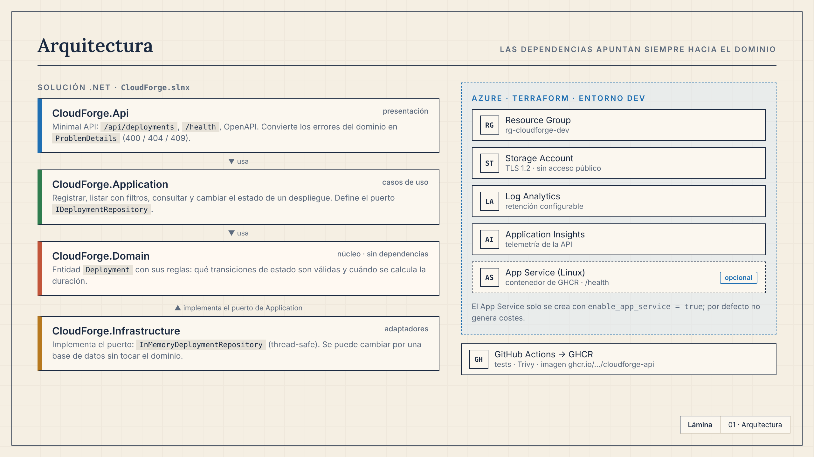
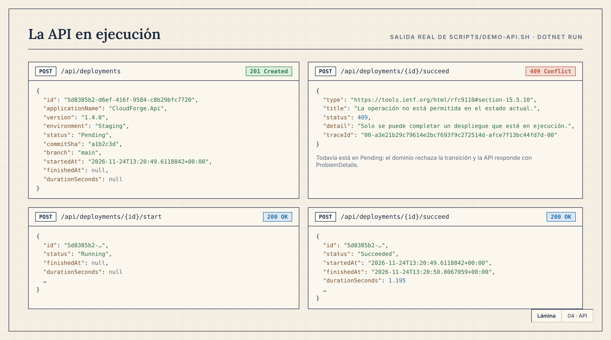
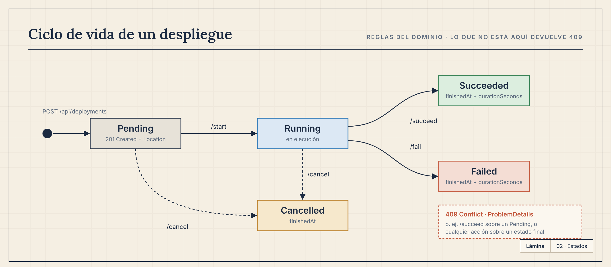
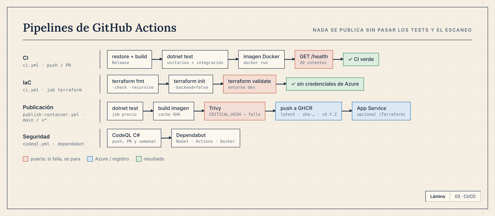

<p align="center">
  
</p>

<p align="center">
  <a href="https://github.com/hectormac35/CloudForge/actions/workflows/ci.yml"></a>
  <a href="https://github.com/hectormac35/CloudForge/actions/workflows/codeql.yml"></a>
  
  
  
</p>

**CloudForge** es una API REST para **registrar despliegues de software y seguir su estado** (pendiente → en ejecución → correcto / fallido / cancelado). La API es pequeña a propósito: lo que el proyecto quiere enseñar es todo lo que la rodea, es decir, una arquitectura por capas con tests, una imagen Docker que se analiza antes de publicarse, y la infraestructura de Azure descrita en Terraform y validada en cada push.

| | |
|---|---|
| **Qué resuelve** | Saber qué versión se desplegó, dónde, desde qué commit, cuánto tardó y cómo terminó. |
| **Stack** | ASP.NET Core 10 (Minimal API) · xUnit · Docker · Terraform · Azure · GitHub Actions |
| **Estado** | API funcional con almacenamiento en memoria; infraestructura de Azure con el App Service opcional. |

---

## Índice

1. [Arquitectura](#1-arquitectura)
2. [La API](#2-la-api)
3. [Ciclo de vida de un despliegue](#3-ciclo-de-vida-de-un-despliegue)
4. [Ejecutarlo en local](#4-ejecutarlo-en-local)
5. [Tests](#5-tests)
6. [Infraestructura en Azure (Terraform)](#6-infraestructura-en-azure-terraform)
7. [CI/CD y seguridad](#7-cicd-y-seguridad)
8. [Decisiones y límites conocidos](#8-decisiones-y-límites-conocidos)

---

## 1. Arquitectura

<p align="center"></p>

La solución sigue **Clean Architecture**: el dominio no depende de nada, y la base de datos o la API se pueden cambiar sin tocar las reglas de negocio. La decisión está documentada en [`docs/decisions/ADR-001`](docs/decisions/ADR-001-clean-architecture.md).

| Proyecto | Responsabilidad | Ejemplos |
|---|---|---|
| `CloudForge.Domain` | Reglas de negocio | `Deployment` con sus transiciones de estado válidas |
| `CloudForge.Application` | Casos de uso y puertos | `RegisterDeployment`, `GetDeployments`, `ChangeDeploymentStatus`, `IDeploymentRepository` |
| `CloudForge.Infrastructure` | Adaptadores | `InMemoryDeploymentRepository` (thread-safe con `ConcurrentDictionary`) |
| `CloudForge.Api` | HTTP | Endpoints, OpenAPI, health check, errores como `ProblemDetails` |
| `CloudForge.SharedKernel` | Piezas comunes | `DomainException` |

<details>
<summary><b>Estructura de carpetas</b></summary>

```text
CloudForge/
├── src/                      # Api · Application · Domain · Infrastructure · SharedKernel
├── tests/CloudForge.Tests/   # Domain · Application · Infrastructure · Api (integración)
├── infrastructure/
│   ├── environments/dev/     # composición del entorno + terraform.tfvars
│   └── modules/              # resource-group · storage · monitoring · app-service
├── docker/Dockerfile         # multi-stage, usuario sin privilegios
├── scripts/demo-api.sh       # recorre el ciclo de vida por HTTP
├── docs/                     # ADR e imágenes
└── .github/                  # ci · publish-container · codeql · dependabot
```
</details>

---

## 2. La API

| Método | Ruta | Respuesta |
|---|---|---|
| `GET` | `/` | Nombre, versión y estado del servicio |
| `GET` | `/health` | `Healthy` (lo usan Docker, la CI y el App Service) |
| `GET` | `/api/deployments?environment=&status=` | Lista, del más reciente al más antiguo, con filtros opcionales |
| `GET` | `/api/deployments/{id}` | `200` o `404` |
| `POST` | `/api/deployments` | `201 Created` con cabecera `Location` · `400` si los datos no son válidos |
| `POST` | `/api/deployments/{id}/start` | `Pending → Running` |
| `POST` | `/api/deployments/{id}/succeed` | `Running → Succeeded` (calcula la duración) |
| `POST` | `/api/deployments/{id}/fail` | `Running → Failed` |
| `POST` | `/api/deployments/{id}/cancel` | Cancela si todavía no ha terminado |

<p align="center"></p>

Los enums viajan como texto (`"Staging"`, `"Running"`) y **todos los errores** siguen el estándar RFC 9457 (`application/problem+json`):

| Situación | Código |
|---|---|
| Faltan datos o el entorno no es válido | `400 Bad Request` |
| El despliegue no existe | `404 Not Found` |
| La transición no está permitida (p. ej. `succeed` sobre un `Pending`) | `409 Conflict` |

<details>
<summary><b>Ejemplo: registrar un despliegue</b></summary>

```http
POST /api/deployments
Content-Type: application/json

{
  "applicationName": "CloudForge.Api",
  "version": "1.4.0",
  "environment": "Staging",
  "commitSha": "a1b2c3d",
  "branch": "main"
}
```

Entornos válidos: `Development`, `Staging`, `Production`.
</details>

---

## 3. Ciclo de vida de un despliegue

<p align="center"></p>

Las reglas viven en la entidad `Deployment` (capa de dominio), no en los endpoints. La API solo traduce: si el dominio lanza `DomainException`, la respuesta es un `409`.

---

## 4. Ejecutarlo en local

**Requisitos:** .NET SDK 10 (la versión exacta está fijada en `global.json`) y, si quieres, Docker.

```bash
git clone https://github.com/hectormac35/CloudForge.git
cd CloudForge

dotnet test                                 # compila y pasa todos los tests
dotnet run --project src/CloudForge.Api     # http://localhost:5112  (OpenAPI en /openapi/v1.json)
```

Con Docker:

```bash
docker build -f docker/Dockerfile -t cloudforge-api .
docker run --rm -p 8080:8080 cloudforge-api
```

Y para ver el ciclo completo por HTTP (registrar → intento no válido → start → succeed → listar):

```bash
./scripts/demo-api.sh                        # contra Docker (puerto 8080)
./scripts/demo-api.sh http://localhost:5112  # contra dotnet run
```

> Los datos se guardan **en memoria**: se pierden al reiniciar la API. Está hecho así a propósito para que el proyecto arranque sin dependencias; ver [límites conocidos](#8-decisiones-y-límites-conocidos).

---

## 5. Tests

| Capa | Qué se comprueba |
|---|---|
| Dominio | Validaciones del constructor, transiciones válidas y no válidas, duración, entorno no definido |
| Aplicación | Registro, filtros y orden del listado, cambios de estado, despliegue inexistente |
| Infraestructura | Repositorio en memoria: alta, duplicados, actualización y 200 altas concurrentes |
| API (integración) | Con `WebApplicationFactory`: `201` + `Location`, ciclo completo por HTTP, `400`, `404`, `409` con `ProblemDetails`, filtros y enums como texto |

```bash
dotnet test --collect:"XPlat Code Coverage"   # con informe de cobertura (coverlet)
```

---

## 6. Infraestructura en Azure (Terraform)

| Recurso | Módulo | Notas |
|---|---|---|
| Resource Group | `resource-group` | `rg-cloudforge-dev` |
| Storage Account | `storage` | TLS 1.2 mínimo, sin blobs públicos |
| Log Analytics Workspace | `monitoring` | Retención configurable (`log_retention_days`) |
| Application Insights | `monitoring` | Basado en el workspace |
| App Service Plan + Linux Web App | `app-service` | **Opcional**: ejecuta la imagen de GHCR, health check en `/health` |

Todos los recursos llevan las etiquetas `project`, `environment` y `managed_by`, y el entorno sale de una variable en vez de estar escrito a mano.

```bash
cd infrastructure/environments/dev
az login
terraform init
terraform plan                                   # solo RG, storage y monitorización
terraform plan -var="enable_app_service=true" \
               -var="web_app_name=app-cloudforge-<sufijo-unico>"   # añade la API
```

<details>
<summary><b>Por qué el App Service está desactivado por defecto</b></summary>

`enable_app_service` vale `false` para que un `terraform apply` sin pensar no cree recursos que puedan costar dinero. Con el plan `F1` (gratuito) `always_on` se desactiva automáticamente, porque ese plan no lo admite. La imagen tiene que ser pública en GHCR, o habría que añadir credenciales del registro.
</details>

> El estado de Terraform (`*.tfstate`) y los planes (`tfplan`) están en `.gitignore`: contienen claves de los recursos y **nunca** deben subirse al repositorio.

---

## 7. CI/CD y seguridad

<p align="center"></p>

| Workflow | Cuándo | Qué hace |
|---|---|---|
| `ci.yml` | push y PR | build + tests · `terraform fmt` y `validate` (sin credenciales) · construye la imagen y espera a que `/health` responda |
| `publish-container.yml` | push a `main` y etiquetas `v*` | vuelve a pasar los tests → construye la imagen → **Trivy** (falla con vulnerabilidades críticas o altas que tengan parche) → publica en GHCR |
| `codeql.yml` | push, PR y cada lunes | análisis estático de C# |
| `dependabot.yml` | semanal | actualizaciones de NuGet, GitHub Actions y la imagen base |

La imagen Docker es multi-stage, se ejecuta con un usuario sin privilegios (`$APP_UID`) y no incluye el SDK.

---

## 8. Decisiones y límites conocidos

| Tema | Situación actual | Siguiente paso |
|---|---|---|
| Persistencia | En memoria (se pierde al reiniciar) | Repositorio con EF Core + Azure SQL o PostgreSQL detrás del mismo `IDeploymentRepository` |
| Autenticación | La API es abierta | API key o Entra ID antes de exponerla públicamente |
| Despliegue continuo | La imagen se publica sola; el App Service se crea con Terraform | Job que actualice el App Service tras publicar la imagen |
| Estado remoto de Terraform | Local | Backend en Azure Storage con bloqueo |
| Entornos | Solo `dev` | `prod` reutilizando los mismos módulos |

---

<sub>Proyecto de portfolio de <b>Héctor Macarrilla</b> · .NET · Azure (AZ-104) · DevOps</sub>
